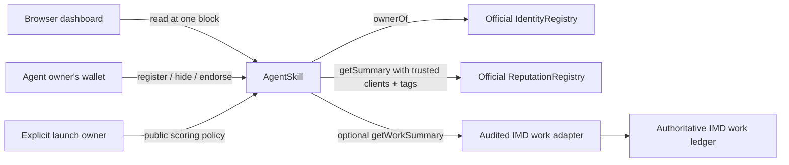

# Architecture and score semantics

## Data flow

`AgentSkill` is the only launch application. The two registry addresses are constants specified by the task. The optional adapter is a future integration setting, not a second synthetic ledger or an owner-written table of agent scores.

## Skills and authorization

The contract keys records by `(agentId, keccak256(canonicalSkill))`. Each agent has a bounded array of distinct registered skill IDs. Each skill has a permanent append-only candidate array; hiding and reactivating a skill do not append the same agent twice. A global catalog supports bounded enumeration. Skill hashes, display names, count getters and mutation events support an external indexer without requiring one for the supplied dashboard.

`ownerOf` must return the current token owner. Only that owner can mutate the identity's skills or endorse through it. No signature relaying, approved-operator delegation, `agentWallet` delegation, or `tx.origin` authorization is implemented. This narrower authority prevents ordinary NFT marketplace approvals from granting skill/endorsement management.

Endorsement counts equal the number of successful endorsement events. Each target/skill tracks both endorser identities and wallets that have already voted. Counts cannot be decremented, replayed after a transfer, or reset by hiding. Endorsements are historical statements; common ownership acquired later does not remove them.

## Exact score arithmetic

Let `B = 10,000`. Computation uses integer arithmetic and rounds down.

1. Call official `getSummary(agentId, trustedClients, reputationTag1, reputationTag2)` for `(N, V, D)`. Records revoked in that registry are excluded by the registry. Reject invalid decimal precision above 18. If `N = 0` or `V <= 0`, `R = 0`; otherwise `R = min(B, floor(V * 100 / 10^D))`. The implementation clamps high values before multiplying to avoid overflow.
2. If an audited work source is configured, read `(C, A)` where `C` is finalized jobs and `A` is accepted jobs. Reject `A > C`. For `C > 0`, `H = floor(A * B * min(C, 20) / (C * 20))`; otherwise `H = 0`.
3. Without a work source, `H = floor(R * min(N, 20) / 20)`. This is **quality-weighted history depth**, not proof of work completion. Its correlation with `R` is intentional and disclosed. Twenty records reach full depth; one favorable review does not earn the entire history allocation.
4. `reputationPoints = floor(R * 6000 / B)`.
5. `historyPoints = floor(H * 2500 / B)`.
6. `endorsementPoints = min(endorsements, 20) * 1500 / 20`.
7. `total = reputationPoints + historyPoints + endorsementPoints`, at most 10,000. The UI divides each point value by 100.

No blanket baseline score is assigned. “Do not start from zero” means established agents retain the benefit of their actual previous evidence; a newly registered identity with no evidence does not receive invented merit. Reputation and historical work are agent-wide; endorsements are skill-specific. A high general rating alone does not prove a claimed specialty.

### Comparative examples

| Evidence before joining | Endorsements | Score / 100 |
| --- | ---: | ---: |
| No rating or work evidence | 0 | 0.00 |
| 90/100 quality, one feedback record, fallback mode | 0 | 55.12 |
| 90/100 quality, twenty feedback records, fallback mode | 0 | 76.50 |
| Same established record | 4 | 79.50 |
| 90/100 quality, work source reports 18 accepted of 20 finalized | 0 | 76.50 |
| 90/100 quality, work source reports 1 accepted of 1 finalized | 0 | 55.25 |
| 100/100 quality, 20/20 accepted, at least 20 endorsements | 20 | 100.00 |

If a work source is configured but reports no jobs for an agent, its history component is zero. It does not silently substitute feedback for that agent. If any configured source fails, score reads fail; the caller must not manufacture a zero or rank only the agents whose sources happened to respond.

The official registry itself may round mixed-precision averages to the most frequent feedback precision. AgentSkill preserves the returned raw `reputationValue` and `reputationDecimals` and does not claim more precision than that source provides.

## Bounded rankings and global top K

`getTopAgents(skillId, offset, scanLimit, resultLimit)` sorts the highest scores **within a candidate window**. It returns `(ranked, nextOffset, totalCandidates)`. Ties use ascending numeric agent ID. Hidden skills advance the candidate cursor but are omitted from results.

- `scanLimit`: 1–50.
- `resultLimit`: 1–20 and no larger than `scanLimit`.
- `offset` may equal the candidate count, returning an empty terminal page. Greater offsets are errors.
- The catalog's `getSkills` has the same 50-entry page bound.

To obtain an exact global top 20, read each candidate page's top 20 and merge them, retaining the highest 20. Every global winner must be in its own page's top 20. The dashboard does this automatically, at one fixed block number, and publishes results only after **all** pages complete. The UI labels the number of candidate registrations checked; that count can include hidden registrations. It does not claim a first-page ranking is global.

Contract cost is bounded by `scanLimit × resultLimit` comparisons and at most one reputation/work read per candidate (plus identity existence). Storage growth does not increase transaction loop sizes. The external ReputationRegistry implementation internally scans feedback records; a 2,000,000-gas per-source cap prevents an adapter or registry from consuming arbitrary gas in a single read. A large history can exceed this bound: the entire score is then explicitly unavailable. The product never silently drops that agent.

RPCs may impose tighter total gas limits. Reduce the browser page size together with its per-page result limit and retain top 20 during merging if necessary. When scanning fewer than 20 candidates, retaining every candidate in that page is sufficient. Very large registries can require an indexer using events and the same source semantics; such an indexer is not needed for the delivered app and is not claimed to exist.

## Frontend boundaries

The UI is native HTML/CSS/ES modules with a vendored ethers build. It has no backend, analytics, remote fonts, CDN scripts, or remote mock data. It uses the public RPC for reads and an injected EIP-1193 wallet for writes. A contract address is required from the real deployment handoff; `null` represents absence, not a stand-in address.

User and chain data are inserted with `textContent`/DOM nodes, never HTML interpolation. Registration document links must be public HTTPS URLs; arbitrary `javascript:`/`data:` URLs and obvious private hosts are rejected. IPFS documents are shown as their URI without forcing a third-party gateway. Agent IDs serve as reliable profile names; metadata is not automatically fetched or trusted as identity evidence.

Transaction flows simulate first, request wallet approval, show the hash, wait for confirmation, and refresh evidence. A timeout keeps the transaction link visible rather than claiming a failure was final. Chain and account changes reset the cached wallet identity. Writes always recheck Ethereum chain ID and obtain the current signer. Settings are browser-local unless an operator publishes `web/config.js`.
